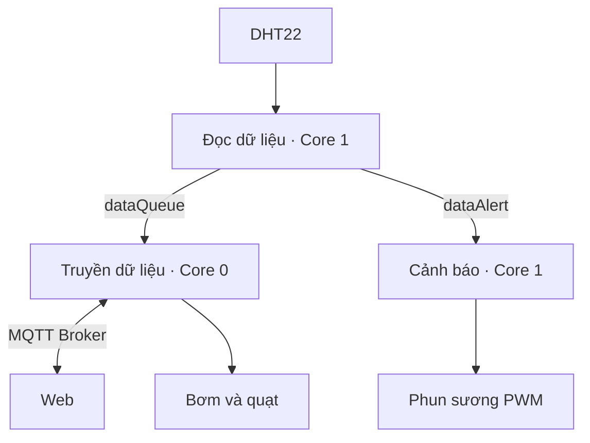

# [LAB3] Hệ thống giám sát môi trường vườn trồng – ESP32 + FreeRTOS

| | |
|---|---|
| **Môn học** | Hệ thống Nhúng – Lab3 |
| **Sinh viên** | Trần Thế Đức |
| **MSV** | 231432220 |
| **Lớp** | — |

ESP32 đọc nhiệt độ và độ ẩm không khí từ **DHT22**, hiển thị qua **Serial** và gửi dữ liệu qua Wi-Fi đến **MQTT Broker** để hiển thị trên **Web**. Máy phun sương tự động chạy khi độ ẩm dưới 40%. Hai nút trên Web điều khiển máy bơm và quạt thủ công. Chương trình dùng **FreeRTOS** với 3 task trên 2 lõi.

🔗 **Mô phỏng Wokwi:** https://wokwi.com/projects/480656607152456705

## 📁 Nội dung repository

| Đường dẫn | Mô tả |
|---|---|
| [esp32/sketch.ino](esp32/sketch.ino) | Chương trình ESP32 (FreeRTOS: 3 task, 2 queue, 1 mutex) |
| [web/index.html](web/index.html) | Giao diện Web (MQTT.js và hai biểu đồ Canvas) |
| [report/\[LAB3_fnTD\] reportNhung_FreeRTOS.pdf](report/%5BLAB3_fnTD%5D%20reportNhung_FreeRTOS.pdf) | Báo cáo (PDF) |
| [report/\[LAB3_fnTD\] reportNhung_FreeRTOS.docx](report/%5BLAB3_fnTD%5D%20reportNhung_FreeRTOS.docx) | Báo cáo (Word) |
| [wokwi_link.txt](wokwi_link.txt) | Link mô phỏng Wokwi |

## 🔌 Sơ đồ kết nối

| Thiết bị | Chân ESP32 | Chức năng |
|---|---|---|
| DHT22 SDA | GPIO27 | Dữ liệu, kéo lên 3V3 qua 10 kΩ |
| DHT22 VCC | 3V3 | Nguồn |
| DHT22 GND | GND | Nối đất |
| LED đỏ qua 220 Ω | GPIO26 | Máy bơm |
| LED xanh lá qua 220 Ω | GPIO25 | Quạt |
| LED xanh dương qua 220 Ω | GPIO33 | Phun sương PWM |

## ⚙️ Kiến trúc FreeRTOS

| Task | Core | Ưu tiên | Stack (B) | Chức năng |
|---|---:|---:|---:|---|
| Truyền data | 0 | 1 | 8192 | Kết nối Wi-Fi và MQTT, lấy mẫu từ `dataQueue`, gửi dữ liệu và nhận lệnh từ Web |
| Đọc data | 1 | 2 | 4096 | Đọc DHT22 mỗi 2,5 s, in Serial, gửi cả mẫu vào `dataQueue` và độ ẩm vào `dataAlert` |
| Cảnh báo | 1 | 3 | 4096 | Đọc `dataAlert`, chạy 25% trong 10 s khi 35–<40%, 50% trong 20 s khi 30–<35% và 100% trong 30 s khi dưới 30%. Dừng ở ≥40% hoặc khi mẫu lỗi/quá hạn |

| Đối tượng | Loại | Vai trò |
|---|---|---|
| `dataQueue` | Queue (1 phần tử) | Giữ mẫu nhiệt độ, độ ẩm, thời điểm đo và cờ hợp lệ mới nhất |
| `dataAlert` | Queue (1 phần tử) | Giữ độ ẩm mới nhất hoặc NaN khi cảm biến lỗi |
| `outputMutex` | Mutex | Đồng bộ trạng thái bơm, quạt và phun sương giữa hai lõi |

**Điều khiển thủ công:** Hai nút Web bật hoặc tắt máy bơm và quạt độc lập. Máy phun sương chạy theo thuật toán độ ẩm, nghỉ 5 giây giữa các đợt nếu vẫn dưới 40%.

## 📡 MQTT

Broker `broker.hivemq.com`. ESP32 dùng TCP cổng `1883`, Web dùng `wss://broker.hivemq.com:8884/mqtt`.

| Topic | Chiều | Nội dung |
|---|---|---|
| `lab3/de2/vuon-dht22-5c8f14/telemetry` | ESP32 → Web | Nhiệt độ, độ ẩm, uptime và cờ hợp lệ |
| `lab3/de2/vuon-dht22-5c8f14/state` | ESP32 → Web | Trạng thái bơm, quạt và mức PWM |
| `lab3/de2/vuon-dht22-5c8f14/availability` | ESP32 → Web | online/offline |
| `lab3/de2/vuon-dht22-5c8f14/cmd/pump` | Web → ESP32 | 1 bật, 0 tắt |
| `lab3/de2/vuon-dht22-5c8f14/cmd/fan` | Web → ESP32 | 1 bật, 0 tắt |

## ▶️ Cách chạy

1. Mở [project Wokwi](https://wokwi.com/projects/480656607152456705) và bấm **Start Simulation**. Theo dõi kết nối MQTT trên Serial Monitor ở 115200 baud.
2. Mở `web/index.html` bằng trình duyệt có Internet để xem số đo và biểu đồ theo thời gian thực.
3. Bấm vào DHT22 trong Wokwi để đổi nhiệt độ hoặc độ ẩm. Quan sát LED xanh dương, Serial và mức PWM trên Web.
4. Dùng hai nút **Bật/Tắt** trên Web để điều khiển bơm và quạt thủ công.

**Thư viện Arduino:** PubSubClient, DHT sensor library, Adafruit Unified Sensor. ESP32 Arduino core cung cấp Wi-Fi, FreeRTOS và LEDC.
